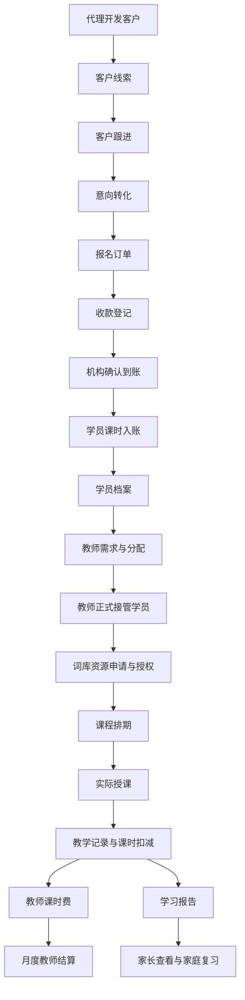
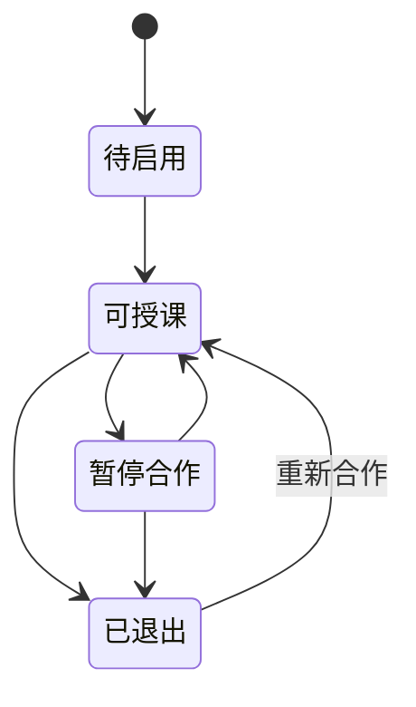
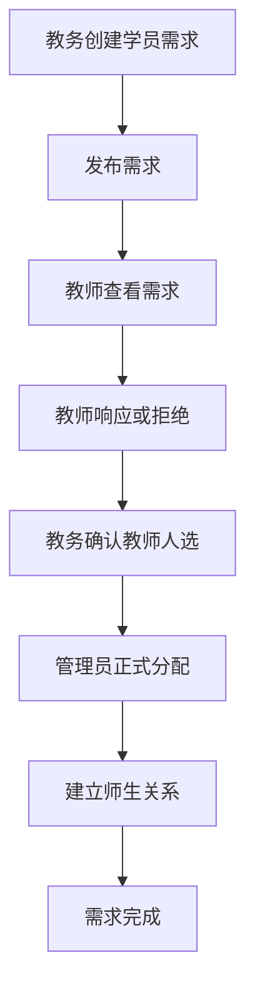
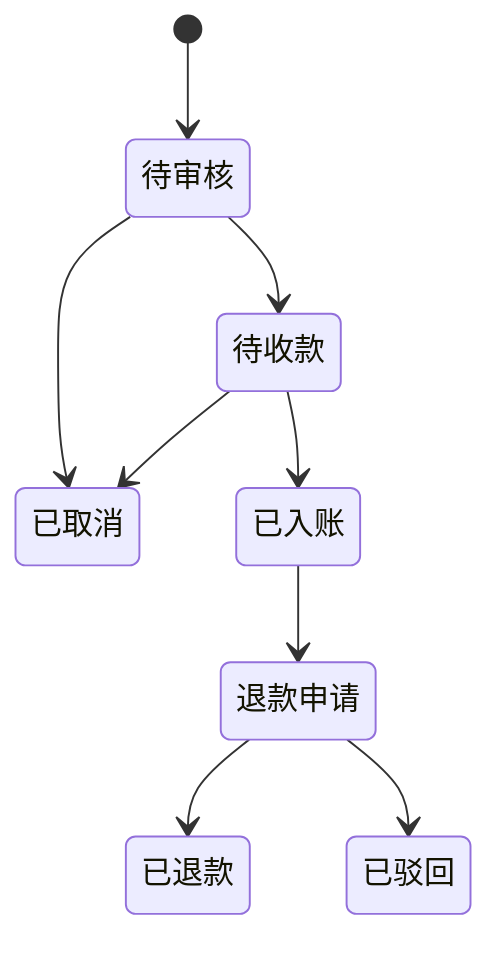
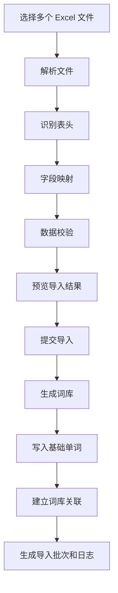
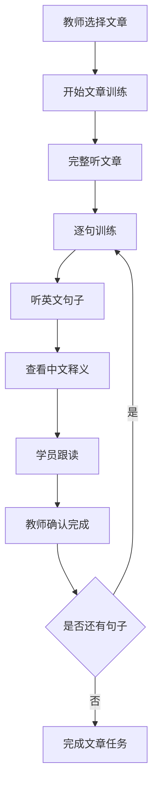
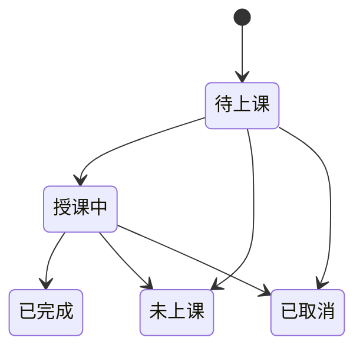
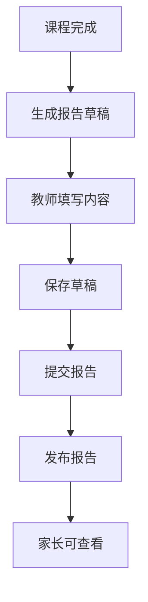

# LearnEnglish 英语一对一教学运营平台
## 产品需求规格说明书（最新代码基线版）

| 项目 | 内容 |
|---|---|
| 产品名称 | LearnEnglish 英语一对一教学运营平台 |
| 文档版本 | PRD V2.0 |
| 文档类型 | 现状基线型产品需求规格说明书（As-Is PRD） |
| 代码基线 | `5d3d41fb28408d25837771ca44301df6b47282d8` |
| Git 分支 | master |
| 基线日期 | 2026-11-04 |
| 当前实现形态 | HTML5 / CSS3 / JavaScript 高保真交互原型 |
| 数据层 | 统一 Store 模拟数据层 |
| 核心业务 | 招生获客、报名收款、教学交付、学习管理、排课、教师结算、家校服务 |

---

# 第一章 产品概述

## 1.1 产品定位

LearnEnglish 是一套面向英语一对一辅导机构的教学运营管理平台。

产品以机构真实经营过程为核心，覆盖从代理招生、客户跟进、报名缴费、学员建档、教师分配、教学资源授权、课程排课、教学执行、学习反馈、家长服务到教师课时费结算的完整业务流程。

产品不是单纯的英语学习工具，也不是简单的教务排课软件，而是连接机构经营、教学交付和财务核算的垂直业务管理系统。

平台需要解决以下核心问题：

1. 招生过程缺乏统一管理，客户信息、代理归属和跟进过程分散。
2. 报名、订单、收款和课时账户之间缺乏严格的数据关联。
3. 兼职教师数量多、流动性高，教师档案、合作关系和账号管理容易混乱。
4. 教师与学员之间的分配、接单和教学资源授权需要明确的业务流程。
5. 日常排课数量较大，周末集中排课时需要高效的批量排课能力。
6. 教学过程缺少统一记录，单词、文章和复习任务无法形成连续学习档案。
7. 家长无法及时了解孩子的课程、学习表现、复习任务和剩余课时。
8. 教师课时费计算依赖人工统计，容易产生漏算、错算和对账争议。
9. 机构管理者缺少统一的经营数据、业务待办和操作审计能力。

## 1.2 产品目标

平台围绕六个业务目标建设：

| 目标 | 产品能力 |
|---|---|
| 招生过程在线化 | 代理管理、客户线索、客户跟进、归属审核 |
| 经营账务在线化 | 商品、订单、收款、课时账户、课时流水 |
| 教学资源标准化 | 教材、词库、文章、单词和资源授权 |
| 教学交付标准化 | 教师管理、学员分配、课程排期、教学记录 |
| 学习过程可追踪 | 单词训练、文章训练、复习计划、学习报告 |
| 运营管理可视化 | 教务工作台、家长服务、教师结算、操作审计 |

## 1.3 产品设计原则

### 原则一：业务事实独立

不同业务对象不能用一个字段代替。

例如：

- 代理获得客户，不等于客户已经报名。
- 教师响应需求，不等于正式分配学员。
- 订单创建，不等于收款成功。
- 收款成功，不等于教师课时费产生。
- 课程排期，不等于实际授课。
- 教师完成授课，不等于家长已经看到学习报告。
- 家长勾选复习，不等于教师确认掌握。

### 原则二：历史记录不可随意覆盖

重要业务动作采用追加记录或独立流水：

- 线索跟进记录。
- 教师合作记录。
- 师生关系历史。
- 课时流水与冲正记录。
- 单词训练与复习记录。
- 结算调整和付款记录。
- 系统操作审计。

### 原则三：教学事实与财务事实分离

学员课时账户代表机构对学员的课时权益。

教师课时费代表机构对教师的应付款。

二者必须使用独立的业务模型、计算规则和流水。

### 原则四：权限必须落实到业务数据

不能只依赖页面隐藏按钮。

所有关键业务操作必须检查操作者身份、角色、数据归属和业务状态。

### 原则五：以真实教学场景为核心

教学过程必须能够记录：

- 教师实际授课。
- 学员实际参与。
- 单词训练过程。
- 单词检测结果。
- 文章训练进度。
- 复习任务。
- 教师反馈。
- 家庭配合情况。

---

# 第二章 用户角色与权限体系

## 2.1 用户角色

系统目前使用六种核心角色。

| 角色编码 | 角色名称 | 核心职责 |
|---|---|---|
| admin | 老板 | 机构经营、财务、权限和全局管理 |
| staff | 教务负责人 | 招生协同、教学运营、排课和学员服务 |
| ops | 管理员 | 日常业务管理、教师分配、订单及结算操作 |
| teacher | 兼职教师 | 授课、教学记录、训练和复习、报告提交 |
| agent | 代理 | 客户开发、线索跟进、报名协助、续费跟进 |
| parent | 家长 | 查看孩子课程、报告、复习和课时信息 |

其中，孩子不是独立的核心后台管理角色，而是通过教师组织的教学过程参与训练。

## 2.2 账号与业务档案分离

系统账号与业务人员档案分开管理。

例如：

- 教师档案保存在教师业务数据中。
- 登录账号保存在统一账号数据中。
- 教师档案通过 `accountId` 关联登录账号。
- 家长档案与账号分离。
- 代理档案与账号分离。

账号状态和业务人员状态是两套独立状态。

教师可以处于暂停合作状态，但其账号也可能处于正常、未开通或已禁用状态。

账号被禁用不代表历史业务数据被删除。

## 2.3 权限管理

系统已实现基于角色的权限体系：

- 角色管理。
- 权限目录。
- 角色权限矩阵。
- 权限修改和恢复默认。
- 用户账号与角色关联。
- 数据范围控制。
- 操作审计。

权限检查通过 Store 中的权限方法实现，包括：

- `can()`
- `assertCan()`
- `hasPermission()`
- `assertPermission()`
- `assertDataAccess()`

数据范围主要包括：

| 数据类型 | 访问边界 |
|---|---|
| 教师数据 | 教师只能操作本人被授权的学员和课程 |
| 代理客户 | 代理只能访问自己负责的客户及相关订单 |
| 家长数据 | 家长只能访问自己关联的孩子 |
| 教师结算 | 教师只能查看和确认自己的结算单 |
| 教务业务 | 按角色权限管理机构业务数据 |
| 系统管理 | 按角色权限维护账号、角色、字典和审计 |

## 2.4 统一身份与数据范围

系统通过统一身份对象识别当前操作者。

数据访问不应相信 URL 中传入的身份 ID。

例如：

- 家长不能通过修改 `parentId` 查看其他家庭数据。
- 教师不能通过修改 `teacherId` 查看其他教师的课程。
- 代理不能通过修改 `agentId` 查看其他代理的客户。
- 教师不能通过直接调用 Store 方法绕过教师归属检查。

---

# 第三章 产品功能架构

## 3.1 功能模块

产品当前包含以下主要业务模块。

| 一级模块 | 二级功能 |
|---|---|
| 机构经营管理 | 经营概览、学员、家长、教师、代理、线索、订单、收款、课时、课程、排课 |
| 教学资源中心 | 教材、单词、词库、文章、Excel 批量导入 |
| 教师教学工作台 | 今日课程、学员档案、单词训练、文章训练、复习、教学报告 |
| 家长服务中心 | 家庭首页、课程记录、学习报告、复习单词、课时、咨询、通知 |
| 代理业务中心 | 工作台、客户报备、客户跟进、订单进度、续费机会、佣金预估 |
| 系统管理 | 账号、角色、权限、操作日志、数据字典、机构设置、通知规则 |

## 3.2 业务流程总览



---

# 第四章 机构经营管理

## 4.1 经营概览

### 功能目标

为机构管理人员提供经营情况和日常待办入口。

### 当前功能

经营概览包含：

- 经营统计展示。
- 教务今日待办。
- 待排课需求。
- 待补充会议链接。
- 待审核业务。
- 待收款订单。
- 异常课程。
- 未回复家长咨询。
- 超时未发布报告。
- 关键数据下钻入口。

### 教务工作台数据接口

`eduWorkbench()` 返回：

- 待办数量。
- 待办列表。
- 订单统计。
- 异常业务。

配套接口包括：

| 接口 | 作用 |
|---|---|
| `coursesMissingMeeting()` | 查询缺少会议链接的课程 |
| `batchFillMeeting()` | 批量补充会议链接 |
| `abnormalCourses()` | 查询异常课程 |
| `courseWorkNote()` | 记录异常课程处理备注 |
| `orderQuickStat()` | 查询订单快速统计 |
| `overdueReports()` | 查询超时未发布报告 |
| `unrepliedInquiries()` | 查询未回复咨询 |
| `studentsWithOpenTrainTask()` | 查询存在未完成训练任务的学员 |
| `inactiveStudents()` | 查询一段时间没有完成课程的学员 |
| `setStudentEduNote()` | 保存教务内部备注 |

### 业务规则

1. 待办数量必须来自对应业务数据。
2. 点击待办可以进入对应业务处理页面。
3. 处理完成后，待办应从列表中消失或更新状态。
4. 教务备注仅内部人员可见。
5. 异常课程处理必须记录处理说明。

**实现状态说明：**教务待办聚合已经接入 Store；经营概览顶部部分统计仍使用种子数据，不能将其认定为真实经营指标。

## 4.2 学员管理

### 功能目标

统一管理学员基本档案、学习情况、家庭关系、课时和教学服务。

### 学员基本资料

包括：

- 学员编号。
- 姓名。
- 年级。
- 教材版本。
- 学习阶段。
- 联系信息。
- 备注。
- 档案状态。
- 当前负责教师。
- 家长关联关系。

### 学员详情

学员详情包含多个业务视图：

1. 基础资料。
2. 家长信息。
3. 当前教师。
4. 历史教师。
5. 课程记录。
6. 学习档案。
7. 课时情况。
8. 教务内部备注。

### 学员筛选

支持：

- 学员姓名和编号搜索。
- 年级筛选。
- 教师筛选。
- 有未完成训练任务筛选。
- 近七天无完成课程筛选。
- 课时不足等运营条件。

### 学员关系规则

1. 学员档案不依赖某一个家长账号存在。
2. 一个学员可以关联多个家长。
3. 一个家长可以关联多个学员。
4. 当前负责教师以师生关系数据为准。
5. 学员的教师缓存字段不作为师生关系的唯一事实来源。
6. 历史课程必须保留授课时的教师信息。
7. 学员新建时不自动获得课时，课时初始余额为零。

## 4.3 家长管理

### 功能目标

维护家长档案及家长与学员之间的关系。

### 功能

- 家长列表。
- 家长详情。
- 家长账号关联。
- 家长与学员关联。
- 多孩子管理。
- 主要联系人关系。
- 家长联系方式。
- 家长服务咨询。

### 关系规则

家长与学员使用独立关系数据 `parentStudents` 管理。

支持：

- 创建关系。
- 解除关系。
- 查询关联学员。
- 当前家庭孩子切换。
- 家长访问权限校验。

解除关系后，该家长不能继续查看孩子的新数据，但历史课程和历史教学数据必须保留。

## 4.4 兼职教师管理

### 功能目标

管理机构兼职教师资源，支持教师反复加入、暂停、恢复和退出。

### 教师基本档案

包括：

- 教师编号。
- 姓名。
- 手机号。
- 性别。
- 学校。
- 专业。
- 学历。
- 年级。
- 教学教材。
- 可教年级。
- 教学标签。
- 自我介绍。
- 合作状态。
- 账号关联。
- 可授课时间。

### 教师合作状态



### 教师详情

教师详情包含：

1. 基础资料。
2. 教学能力。
3. 当前学员。
4. 历史学员。
5. 课程安排。
6. 授课记录。
7. 合作记录。
8. 教学统计。

### 教师生命周期规则

1. 教师档案不能物理删除。
2. 手机号唯一。
3. 教师退出后重新合作，应恢复原档案。
4. 暂停合作期间不能接收新学员。
5. 暂停合作不自动删除现有师生关系。
6. 教师退出前需要检查当前学员、未来课程和待提交教学记录。
7. 正式退出需要处理后续课程安排和学员交接。
8. 账号状态与教师合作状态相互独立。
9. 教师历史授课记录不能因为教师改派而被覆盖。

### 师生关系

使用独立的 `teacherStudents` 记录当前和历史关系。

主要操作：

- 分配教师。
- 转移学员。
- 解除关系。
- 查询当前关系。
- 查询历史关系。

`TeacherStudent` 是当前负责教师的主要事实来源。

学生档案中的教师名称等字段只是兼容旧页面的缓存信息。

### 教师教学统计

包括：

- 已完成课程数量。
- 已授课时长。
- 本月课程数量。
- 本月授课时长。
- 历史月份统计。
- 课程完成情况。
- 未来课程数量。
- 待处理教学记录。
- 教师关注学员。

教师课时费统计另走独立的薪酬模块。

## 4.5 学员需求与教师接单

### 功能目标

建立教师需求发布、教师响应、教务确认、管理员正式分配的完整流程。

### 业务参与方

- 教务：创建需求、发布需求、确认教师人选。
- 教师：查看开放需求、响应、拒绝或撤回。
- 管理员：正式分配教师。
- 系统：记录各环节状态和操作日志。

### 业务流程



### 需求信息

包括：

- 学员。
- 年级。
- 教材。
- 教学要求。
- 时间要求。
- 需求说明。
- 创建人。
- 发布时间。
- 当前状态。

### 教师响应

教师可以：

- 响应需求。
- 拒绝需求。
- 撤回响应。

教师响应只代表接单意向，不产生正式师生关系。

### 教务确认

教务可以确认候选教师。

确认后仍需要管理员正式分配。

确认可以撤销，但必须保留历史记录。

### 管理员分配

管理员正式分配后：

- 建立师生关系。
- 更新当前负责教师。
- 记录分配人和分配时间。
- 需求进入完成状态。
- 历史响应和确认记录保留。

### 关键规则

1. 教务不能越权执行正式分配。
2. 管理员不能代替教务确认教师。
3. 教师只能响应对自己开放的需求。
4. 不能根据响应人数自动判断需求完成。
5. 只有正式分配才能建立正式师生关系。

## 4.6 教学资源申请与授权

教师负责学员后，可以为学员申请教学词库。

### 业务流程

1. 教师进入本人负责的学员档案。
2. 查询机构可用词库。
3. 创建词库申请。
4. 管理员审核。
5. 审核通过后建立学员词库授权。
6. 教师只能使用学员已授权的词库开展训练。

### 业务对象

- `studentWordbookRequests`：词库申请。
- `studentWordbooks`：学员词库授权。

### 规则

1. 词库申请不等于授权。
2. 教师只能为本人负责的学员申请词库。
3. 资源授权和师生关系是两个独立对象。
4. 授权可以停用，也可以重新启用。
5. 已产生的历史训练记录不能因为授权停用而消失。
6. 教师启动训练时必须校验学员词库授权。

## 4.7 客户线索与代理管理

### 功能目标

管理代理招生和客户转化过程。

### 代理档案

包括：

- 代理编号。
- 姓名。
- 联系方式。
- 合作状态。
- 登录账号。
- 合作记录。
- 负责客户。
- 业绩统计。

### 客户线索

包括：

- 客户编号。
- 家长姓名。
- 手机号。
- 意向学员。
- 年级。
- 教材。
- 客户来源。
- 获客代理。
- 当前维护人。
- 客户等级。
- 当前状态。
- 下次跟进时间。
- 最近跟进记录。

### 代理归属

系统需要区分三个概念：

1. 获客归属：最初由谁开发。
2. 维护归属：当前由谁负责跟进。
3. 成交归属：本次订单由哪个代理促成。

三个归属必须独立保存。

代理归属变更写入线索日志，不覆盖历史归属。

### 客户跟进

结构化跟进字段包括：

- 客户等级。
- 关注问题。
- 决策人。
- 预算情况。
- 下一步行动。
- 跟进时间。
- 跟进内容。

跟进记录追加保存。

客户等级和下次行动可同步到线索当前状态。

### 客户报备

代理可以批量报备客户。

规则：

- 手机号进行重复检测。
- 重复客户不能直接建立重复线索。
- 存在归属争议时进入审核处理。
- 代理只能查看自己负责的客户。

### 线索转化

客户意向明确后，可以引导进入：

- 建立家长档案。
- 建立学员档案。
- 创建报名订单。
- 分配教师。
- 创建课程。

当前代码支持线索到报名相关流程，但试听节点与线索成交的完整联动尚未全部实现。

## 4.8 订单与商品管理

### 课程商品

商品用于定义机构销售的课程套餐。

包括：

- 商品名称。
- 商品价格。
- 课时数量。
- 有效期。
- 商品状态。
- 适用范围。

### 订单

订单记录家长购买课程的业务事实。

包括：

- 订单编号。
- 家长。
- 学员。
- 商品。
- 订单金额。
- 购买课时。
- 成交代理。
- 创建人。
- 创建时间。
- 订单状态。
- 订单日志。

### 订单流程



说明：具体状态以 Store 枚举和订单页面为准，退款申请是独立退款流程，不应直接覆盖历史订单和收款记录。

### 订单规则

1. 新建订单不直接增加学员课时。
2. 订单审核与收款确认是不同操作。
3. 只有确认到账后才能生成正式课时账户和流水。
4. 新建家长和学员不会自动产生课时。
5. 订单必须关联学员。
6. 订单必须保留商品和购买课时信息。
7. 订单状态变化必须记录日志。
8. 取消订单需要记录原因。
9. 代理可以查看自己客户订单的业务进度，但不能查看内部收款流水。

## 4.9 收款管理

### 功能目标

记录机构实际收到的学费。

收款登记和收款确认分开。

### 收款信息

包括：

- 订单编号。
- 收款金额。
- 收款方式。
- 收款时间。
- 交易流水号。
- 登记人。
- 收款凭证链接。
- 收款状态。

### 收款流程

1. 代理或管理人员根据权限登记收款信息。
2. 管理员确认实际到账。
3. 确认后生成正式付款记录。
4. 生成或更新学员课时账户。
5. 写入课时入账流水。
6. 更新订单状态。
7. 更新线索成交状态。
8. 更新相关续费机会。

收款确认、课时入账、成交更新等关键操作需要保证整体业务一致性。

### 当前实现边界

- 已有收款登记和确认流程。
- 已有收款记录。
- 已有课时入账。
- 已有订单日志。
- 在线支付渠道未接入。
- 当前主要按全额入账处理，部分收款规则尚未完整设计。
- 凭证目前以链接形式记录，尚未实现完整文件上传。

## 4.10 学员课时账户

### 功能目标

管理学员购买课程后形成的课时权益。

### 账户字段

- 学员。
- 订单。
- 商品。
- 总课时。
- 已用课时。
- 剩余课时。
- 生效日期。
- 到期日期。
- 账户状态。

### 课时流水

所有课时变化必须写入独立流水。

流水包括：

- 流水编号。
- 学员。
- 账户。
- 业务类型。
- 变动数量。
- 变动前余额。
- 变动后余额。
- 关联课程或订单。
- 操作人。
- 操作时间。
- 变动原因。

### 课时扣减规则

1. 课程完成后才触发正常扣课。
2. 未上课不扣课。
3. 已取消课程不扣课。
4. 余额不足不能扣成负数。
5. 扣课失败进入异常状态，等待处理。
6. 重复完成不能重复扣课。
7. 误扣通过冲正处理。
8. 冲正不能删除原始流水。
9. 多个套餐账户分别管理，不应简单合并为一个不可追溯的余额。

### 课时预警

包括：

- 剩余课时不足。
- 套餐即将到期。
- 剩余课时可使用周数估算。
- 续费快捷入口。

---

# 第五章 教学资源中心

## 5.1 教材管理

### 功能目标

建立可扩展的教材结构，支持不同教材版本和年级。

### 教材层级

```text
教材版本
  └── 年级
       └── 学期
            └── 单元
                 ├── 单词词库
                 └── 文章资源
```

教材结构不能写死为某一个版本。

需要支持人教版、外研版、WOWEnglish 等不同教材资源。

## 5.2 单词管理

### 基础单词

基础单词是平台中的独立资源。

包括：

- 英文单词。
- 音标。
- 发音资源。
- 词性。
- 中文释义。
- 备注。

一个基础单词可以具有多个释义。

同一个基础单词可以被多个词库引用。

### 词库与单词关系

词库和基础单词是多对多关系。

通过 `wordbookWords` 维护关联。

每个词库具有独立排序。

同一个单词在不同词库中的顺序可以不同。

从某个词库移除单词，不能直接删除基础单词，也不能影响其他词库。

## 5.3 词库管理

### 词库信息

包括：

- 词库名称。
- 教材版本。
- 年级。
- 学期。
- 单元。
- 分类。
- 来源。
- 状态。
- 单词数量。
- 关联数量。

### 词库操作

- 创建词库。
- 修改词库。
- 启用或停用。
- 添加单词。
- 移除单词。
- 调整顺序。
- 查询关联单词。
- 查询被哪些词库引用。

词库停用不等于删除历史学习数据。

## 5.4 Excel 批量导入

### 功能目标

通过 Excel 文件批量建立词库和基础单词，降低资源录入成本。

### 导入流程



### 文件规则

1. 支持一次选择多个 Excel 文件。
2. 默认一个文件生成一个词库。
3. 默认使用文件名作为词库名称。
4. 允许修改词库名称。
5. 支持浏览器端解析 Excel。
6. 支持 `.xlsx` 和当前解析能力支持的 `.xls` 文件。

### 字段识别

系统需要识别：

- 英文。
- 音标。
- 词性。
- 中文释义。
- 音频资源。

支持中英文表头识别和手动字段映射。

### 数据校验

包括：

- 必填字段缺失。
- 文件内重复。
- 系统已有单词。
- 非法英文内容。
- 无法识别的表头。
- 字段格式异常。

### 导入规则

1. 基础单词按统一 Word ID 管理。
2. 相同基础单词跨词库复用。
3. 每个词库单独建立单词关联。
4. 每个词库独立排序。
5. 单个文件原子性提交。
6. 某个文件失败不能破坏其他文件的导入。
7. 导入失败需要记录失败原因。
8. 支持导出失败行 CSV。
9. 导入操作必须留下批次日志。

### 导入日志

包括：

- 批次编号。
- 文件名称。
- 词库名称。
- 操作人。
- 导入时间。
- 解析数量。
- 新增基础单词数量。
- 新增关联数量。
- 跳过数量。
- 失败数量。
- 失败原因。

## 5.5 文章资源管理

### 文章信息

包括：

- 文章名称。
- 文章内容。
- 适用年级。
- 教材版本。
- 单元。
- 文章音频。
- 文章状态。

### 文章结构

文章由多个句子组成。

每个句子包括：

- 英文内容。
- 中文翻译。
- 音频资源。
- 排序。
- 重点信息。

文章详情需要支持句子拆分和顺序维护。

---

# 第六章 教师教学工作台

## 6.1 今日工作台

### 功能目标

教师登录后直接看到今天需要完成的工作。

### 页面内容

- 今日课程。
- 课程时间。
- 学员信息。
- 会议链接。
- 课程状态。
- 待写教学报告。
- 今日到期复习。
- 需要关注的学员。
- 快捷进入教学任务。

### 教师今日概览

通过 `teacherTodayOverview()` 汇总：

- 今日课程。
- 课程状态。
- 报告状态。
- 待写报告数量。
- 学员情况。

教师只能查看本人课程。

## 6.2 教师需求中心

教师可以查看机构发布的教学需求。

包括：

- 开放需求。
- 已响应需求。
- 已确认需求。
- 需求详情。
- 词库申请。
- 申请状态。

教师只能响应开放给自己的需求。

## 6.3 我的学员

教师只能查看本人当前负责的学员。

学员列表可以查看：

- 学员姓名。
- 年级。
- 教材。
- 课程安排。
- 当前学习状态。
- 今日复习数量。
- 最近训练情况。
- 需要关注的学习问题。

## 6.4 学员学习档案

学员档案用于集中展示学习历史。

主要内容：

1. 基础信息。
2. 单词学习档案。
3. 单词训练历史。
4. 莱特纳复习情况。
5. 21 天复习情况。
6. 文章训练记录。
7. 历史课程。
8. 学习报告。
9. 本节课教学建议。

教师的本节课建议来自真实学习数据，例如：

- 今日到期复习。
- 最近薄弱单词。
- 上一次检测通过率。
- 最近训练任务。

## 6.5 单词学习档案

单词详情需要体现四层数据：

1. 基础单词。
2. 学员单词状态。
3. 单词训练历史。
4. 复习计划与复习记录。

教师可以查看一个单词在不同训练和复习过程中的历史变化。

---

# 第七章 单词训练体系

## 7.1 产品目标

单词训练不是让孩子独立刷题，而是由教师组织的一对一教学过程。

教师根据学员当前学习情况，选择合适词库，带领孩子训练，并根据最终检测结果生成训练报告和后续复习安排。

## 7.2 训练任务创建

### 创建条件

- 选择学员。
- 选择一个或多个词库。
- 检查教师是否负责该学员。
- 检查词库是否已经授权。
- 检查是否存在未完成的相关任务。

### 多词库处理

同一基础单词可能存在于多个词库。

训练任务按基础 Word ID 去重。

但必须保留单词来源词库关系。

### 任务信息

包括：

- 任务编号。
- 学员。
- 教师。
- 关联课程。
- 词库集合。
- 目标数量。
- 单词清单。
- 创建时间。
- 当前阶段。
- 当前进度。
- 任务状态。

## 7.3 预筛选

### 功能目标

教师先带领学员判断哪些单词已经认识，哪些需要强化。

### 操作方式

使用列表形式展示单词。

教师组织孩子逐词判断：

- 认识。
- 不认识。

### 规则

1. 认识的单词记录预筛选结果。
2. 不认识的单词进入训练候选集合。
3. 已经确认认识的单词可从后续候选中排除。
4. 多词库相同单词只保留一条训练记录。
5. 未完成预筛选的单词不能被误认为已掌握。
6. 预筛选认识状态和正式掌握状态必须分开。
7. 预筛选结果可以修正，但必须保留修正历史。

### 数量限制

当前 Store 定义：

- 最少训练单词数：5。
- 最多进入本次训练队列：45。

少于5个时不能进入强化训练。

超过45个时，剩余单词保留待后续处理，不能丢失或标记为已完成。

## 7.4 分组强化训练

### 功能目标

教师带领孩子对筛选出的单词进行分组展示和记忆强化。

### 分组规则

每组最多5个单词。

每个单词独立维护展示进度。

### 展示过程


### 规则

1. 强化阶段只记录展示过程。
2. 不在强化阶段直接判断掌握或不掌握。
3. 每个单词的展示进度独立保存。
4. 当前组全部完成后才能进入下一组。
5. 已完成展示的单词不能重复计数。
6. 中断后能够恢复任务。
7. 展示记录和最终检测记录分开保存。

## 7.5 最终检测

### 功能目标

强化训练结束后，教师统一检查学员掌握情况。

### 检测结果

当前训练报告支持三态语义：

| 检测结果 | 业务含义 |
|---|---|
| yes | 已掌握 |
| mid | 需要加强 |
| no | 尚未掌握 |

页面及报告应使用易于教师理解的中文表达。

### 检测规则

1. 所有待检测单词都必须完成判断。
2. 未全部判断时不能提交任务。
3. 检测结果必须保留原始记录。
4. 允许教师修正误判。
5. 修正时记录修改前后结果、操作人和原因。
6. 重复提交不能重复生成训练报告。
7. 检测结果不直接修改家长家庭复习记录。

## 7.6 训练报告

每个训练任务生成一份训练报告。

报告内容：

- 训练任务。
- 学员。
- 教师。
- 关联词库。
- 训练单词总数。
- 已掌握数量。
- 需要加强数量。
- 尚未掌握数量。
- 掌握率。
- 单词明细。
- 重点单词。
- 后续复习安排。

### 掌握率

掌握率按照已掌握单词数量除以实际参与检测的单词数量计算。

不能把未完成检测的单词算入掌握数量。

### 幂等规则

一个训练任务最多生成一份正式训练报告。

重复完成任务不能重复生成报告。

## 7.7 复习计划生成

当前统一复习计划使用：

- `reviewPlans`
- `reviewRecords`

### 生成原则

训练完成后，根据检测结果形成后续复习计划。

- 已掌握：不进入待加强复习计划。
- 需要加强：进入复习计划。
- 尚未掌握：进入复习计划。

复习策略根据掌握程度选择不同复习间隔。

### 计划版本

同一个学员同一个基础单词，同一时刻只允许一条有效的统一复习计划。

如果重新训练产生新的计划：

- 旧计划归档。
- 新计划建立新版本。
- 历史复习记录保留。

### 重要边界

当前统一复习计划与莱特纳盒子、21 天复习仍保持弱关联。

统一计划的复习操作不会自动改写旧体系的盒子状态或21天任务状态。

不能将三套数据视为同一个状态字段。

---

# 第八章 两套独立复习体系

## 8.1 莱特纳盒子复习

### 功能目标

使用分层复习机制，管理单词的长期记忆情况。

### 盒子状态

- 红盒。
- 黄盒。
- 绿盒。

具体间隔由莱特纳配置决定。

### 功能

- 查询不同盒子单词。
- 查询今日到期单词。
- 创建复习任务。
- 教师判断复习结果。
- 盒子迁移。
- 手动加入绿盒。
- 从绿盒移除。
- 记录复习操作历史。
- 复习任务统计。

### 业务规则

1. 不同盒子有独立的复习间隔。
2. 到期单词可以进入今日复习。
3. 教师可以组织复习任务。
4. 教师可以根据结果调整单词状态。
5. 绿盒支持教师手动维护。
6. 已毕业单词不再进入正常待复习集合。
7. 每次操作需要保留历史记录。

## 8.2 21天记忆复习

### 功能目标

按照21天记忆计划管理单词复习任务。

### 功能

- 创建21天计划。
- 查询计划。
- 查询每日任务。
- 查询今日到期。
- 执行复习。
- 记录判断结果。
- 查看计划进度。
- 查看历史复习记录。
- 完成或取消任务。

### 规则

1. 复习任务按照自己的日期计算。
2. 任务日期不晚于当前日期时才进入到期集合。
3. 已完成任务不重复执行。
4. 已取消计划不再产生正常复习任务。
5. 复习结果记录操作人和时间。
6. 不依赖莱特纳盒子状态。

## 8.3 统一今日复习展示

教师端可以把莱特纳和21天两套体系的今日到期数量汇总展示。

但：

- 汇总只是工作台展示。
- 执行时仍进入对应体系。
- 两套体系的任务状态独立。
- 不能因为合并展示而合并底层数据。

## 8.4 统一复习计划

统一复习计划与莱特纳、21天是三个不同层次：

| 体系 | 主要作用 |
|---|---|
| 莱特纳 | 按盒子间隔管理复习 |
| 21天 | 按21天计划管理复习 |
| 统一复习计划 | 根据训练检测结果安排后续复习 |

三者可以在教师工作台和家长端统一展示，但不能互相覆盖历史状态。

---

# 第九章 文章训练体系

## 9.1 功能目标

教师组织学员进行文章听读训练，记录句子级学习进度。

## 9.2 训练流程



## 9.3 文章训练记录

文章任务包括：

- 学员。
- 教师。
- 文章。
- 关联课程。
- 当前训练状态。
- 文章音频完成状态。
- 句子训练进度。
- 完成时间。

每个句子记录：

- 是否完成。
- 听读情况。
- 教师确认。
- 操作时间。

## 9.4 任务规则

1. 文章训练任务必须绑定学员。
2. 教师必须具有学员教学权限。
3. 句子完成情况独立记录。
4. 训练中断后可以恢复。
5. 任务完成后进入课程教学汇总。
6. 文章训练不直接扣减学员课时。
7. 文章任务完成不自动代表整节课程完成。

---

# 第十章 排课管理体系

## 10.1 产品目标

支持机构日常高频排课和周末集中排课。

当前业务规模目标：

- 学员约1000人。
- 兼职教师约200—300人。
- 普通工作日约20—30节课程。
- 周末约80—100节课程。

排课不能只依赖逐节创建，需要支持单次排课、周期排课、多学员批量排课和批量维护。

## 10.2 课程对象

每节课程都是独立业务对象。

主要字段：

- 课程编号。
- 日期。
- 开始时间。
- 结束时间。
- 学员。
- 教师。
- 课程类型。
- 授课形式。
- 课程状态。
- 会议链接。
- 课程来源。
- 周期编号。
- 批次编号。
- 实际开始时间。
- 实际结束时间。
- 创建人。
- 备注。

### 课程类型与授课形式分离

课程类型：

- 体验课。
- 正式课。
- 历史待确认。

授课形式：

- 一对一。
- 补课。
- 其他。

两个维度不能混用。

## 10.3 排课工作台

### 功能目标

让教务快速了解课程分布、冲突和异常。

### 当前能力

- 课程列表。
- 课程日历。
- 日期筛选。
- 教师筛选。
- 学员筛选。
- 课程状态筛选。
- 课程查询。
- 冲突检查。
- 待补会议链接。
- 批量排课入口。
- 周期排课入口。
- 教师匹配入口。

高密度课程运营需要以列表和批量工作台为主，日历作为辅助视图。

## 10.4 单次排课

### 操作流程

1. 选择学员。
2. 自动带出当前负责教师。
3. 确认或修改教师。
4. 选择日期。
5. 选择开始时间。
6. 选择结束时间。
7. 选择课程类型。
8. 选择授课形式。
9. 填写会议链接和备注。
10. 检查冲突。
11. 创建课程。

### 冲突检查

必须检查：

- 学员时间冲突。
- 教师时间冲突。
- 教师是否可授课。
- 教师可用时间。
- 教师请假或特殊不可用时间。
- 教师负荷限制。
- 学员排课偏好。

硬冲突不能直接提交。

软提醒可以由教务确认后继续。

## 10.5 教师可用时间管理

### 功能目标

维护教师可授课的真实时间范围。

### 时间配置

支持：

- 星期。
- 开始时间。
- 结束时间。
- 固定可用时间段。
- 日期例外。
- 临时请假。
- 临时不可用。
- 恢复可用。

### 负荷管理

支持配置：

- 每日最大授课时长。
- 每周最大授课时长。
- 课程数量限制。
- 连续授课负荷规则。

教师负荷规则与教师可用时间是两个独立约束。

## 10.6 学员排课偏好

学员可以维护：

- 可用星期。
- 偏好时间。
- 不可用时间。
- 每周课程频次。
- 课程时长。
- 有效日期。
- 首选教师。

学员排课偏好独立存储，不能混入学员基础资料。

## 10.7 教师匹配推荐

### 硬性条件

- 教师合作状态必须允许授课。
- 时间必须符合可用范围。
- 不存在教师课程冲突。
- 不存在学员课程冲突。
- 不在请假或不可用时间内。
- 不超过教师负荷限制。

### 软性推荐条件

- 当前负责教师优先。
- 年级和教材匹配。
- 教师教学能力匹配。
- 教师时间偏好。
- 教师负荷均衡。

系统需要展示推荐理由。

推荐结果仅作为教务决策参考，不自动建立新的师生关系。

## 10.8 周期排课

### 功能目标

为固定上课的学员生成未来一段时间的课程实例。

### 配置项

- 学员。
- 教师。
- 课程类型。
- 授课形式。
- 课程时长。
- 起始日期。
- 结束日期。
- 每周星期。
- 每周上课时间。
- 会议链接策略。
- 备注。

### 操作流程

1. 创建周期规则。
2. 生成未来课程预览。
3. 检查每一节课程冲突。
4. 查看异常日期。
5. 调整异常课程。
6. 确认创建。
7. 生成独立课程实例。

### 修改范围

周期规则支持不同范围的维护：

- 修改单节。
- 修改本次及后续。
- 修改整个周期。
- 取消单节。
- 取消后续。
- 取消整个周期。

已完成历史课程必须保留。

## 10.9 多学员批量排课

### 功能目标

解决周末集中排课的效率问题。

### 操作流程

1. 从待排课学员池选择学员。
2. 设置排课日期范围。
3. 选择课程频次和时长。
4. 系统默认当前负责教师。
5. 根据教师时间和能力推荐教师。
6. 允许批量设置教师和时间。
7. 允许逐个学员调整。
8. 生成排课预览。
9. 检查硬冲突和软提醒。
10. 提交可创建的正常课程。
11. 保留冲突和异常行，供教务继续处理。

### 批次数据

每个批次记录：

- 批次编号。
- 创建人。
- 创建时间。
- 学员清单。
- 排课行。
- 创建数量。
- 失败数量。
- 跳过数量。
- 冲突数量。
- 最后提交时间。
- 最后提交人。
- 批次状态。

### 部分提交规则

1. 每一行课程独立校验。
2. 一行冲突不应阻断其他正常行。
3. 硬冲突行不能创建。
4. 软提醒行需要确认。
5. 正常行可以单独创建。
6. 失败行可以修改后重试。
7. 已创建行不能重复创建。
8. 同一批次的行使用唯一标识防止重复提交。

## 10.10 批量课程维护

支持：

- 批量改派教师。
- 批量补充会议链接。
- 批量取消课程。

规则：

- 逐节检查权限和状态。
- 已完成课程不能随意修改。
- 批量操作必须记录原因。
- 每节课程保留自己的业务历史。
- 会议链接不能默认所有课程共用，必须按业务输入明确指定。

## 10.11 排课数据模型

当前相关业务集合：

- `courses`
- `scheduleSeries`
- `scheduleBatches`
- `teacherAvailabilities`
- `teacherAvailabilityExceptions`
- `teacherLoadPolicies`
- `studentSchedulePreferences`

课程是实际课次。

周期规则是未来课程生成规则。

排课批次是批量创建的操作记录。

三者不能互相替代。

---

# 第十一章 课程执行与教学记录

## 11.1 课程状态

课程当前核心状态：

| 状态 | 业务含义 |
|---|---|
| 待上课 | 已创建，等待授课 |
| 授课中 | 教师已经开始授课 |
| 已完成 | 实际授课完成 |
| 未上课 | 课程未实际发生 |
| 已取消 | 课程被取消 |

状态流转：



已完成课程不能重复完成。

已完成课程的授课教师、实际授课时间和课型必须锁定。

## 11.2 开始上课

教师从今日课程进入授课页面。

操作：

- 查看学员。
- 查看课程安排。
- 查看会议链接。
- 开始授课。
- 进入单词训练。
- 进入文章训练。
- 查看今日复习。
- 查看本节课教学建议。

开始授课后写入实际开始时间。

## 11.3 教学记录

每节课程对应教学记录。

教学记录关联：

- 课程。
- 学员。
- 教师。
- 单词训练任务。
- 莱特纳任务。
- 21天任务。
- 文章任务。
- 教学结果。
- 实际开始时间。
- 实际结束时间。

教学记录需要能够回溯本节课实际发生的教学活动。

## 11.4 结束课程

教师完成课程时，系统需要：

1. 检查未完成教学内容。
2. 处理未完成任务。
3. 更新课程教学记录。
4. 写入实际结束时间。
5. 更新课程状态。
6. 扣减学员课时。
7. 生成或关联学习报告草稿。
8. 生成教师课时费明细。
9. 保存课程完成结果。

### 未完成任务处理

支持：

- 保留未完成任务。
- 结束未完成任务。
- 取消未完成任务。

操作必须记录处理原因。

### 幂等规则

重复完成同一课程不能重复：

- 创建课程记录。
- 扣减课时。
- 生成报告。
- 生成教师课时费。

## 11.5 异常课程处理

教务端可以查询：

- 未上课。
- 已取消。
- 扣课异常。
- 其他需要人工处理的课程。

异常处理需要填写备注。

课程异常不应通过直接修改历史数据来消除。

---

# 第十二章 教学报告与家校反馈

## 12.1 教师教学报告

每节课程完成后产生报告草稿。

### 报告内容

1. 课程基本信息。
2. 本节教学汇总。
3. 单词训练情况。
4. 单词掌握情况。
5. 莱特纳复习情况。
6. 21天复习情况。
7. 文章训练情况。
8. 学员表现。
9. 薄弱点。
10. 下一步教学安排。
11. 家庭配合建议。

### 报告状态

- 编辑中。
- 已提交。
- 已发布。

### 报告流程



### 规则

1. 报告和课程状态独立。
2. 课程完成不代表报告已经发布。
3. 家长只能查看已发布且允许家长查看的报告。
4. 草稿不能直接暴露给家长。
5. 报告统计必须来源于真实教学记录。
6. 报告自动带入的训练数据应与课程记录快照一致。

## 12.2 学习反馈

系统支持独立的学习反馈记录。

反馈内容包括：

- 学习表现。
- 薄弱点。
- 下一步安排。
- 家庭建议。
- 发布时间。
- 可见范围。

### 可见性

家长和代理的可见性独立控制：

- `visibleToParent`
- `visibleToAgent`

不能使用同一个开关同时控制家长和代理。

## 12.3 家长预览

教师发布报告前，可以预览家长看到的内容。

预览必须使用家长实际数据投影规则，不能把教师内部信息暴露给家长。

---

# 第十三章 家长服务中心

## 13.1 家长首页

### 功能目标

为家长提供孩子学习情况和家庭配合任务的统一入口。

### 首页信息

- 孩子信息。
- 年级。
- 教材。
- 当前教师。
- 剩余课时。
- 累计完成课程。
- 最近学习时间。
- 今日待复习。
- 最近学习反馈。
- 家庭待办。
- 通知消息。

### 多孩子切换

家长可以切换自己关联的孩子。

当前孩子状态在家长各个页面之间共享。

越权切换必须被拒绝。

## 13.2 课程记录

### 课程筛选

- 全部。
- 待上课。
- 授课中。
- 已完成。
- 未上课。
- 已取消。

### 课程详情

展示：

- 日期。
- 计划时间。
- 实际授课时间。
- 教师。
- 课程主题。
- 课程状态。
- 报告状态。
- 课时扣减情况。
- 取消或未上课原因。

家长只能查看，不能修改课程状态和课时。

历史教师必须显示课程发生时的教师快照。

## 13.3 学习报告

### 报告列表

展示：

- 课程日期。
- 主题。
- 教师。
- 报告摘要。
- 发布时间。
- 查看详情。

支持日期范围筛选。

### 报告详情

包括：

1. 本节课程概况。
2. 单词学习情况。
3. 文章训练情况。
4. 教师反馈。
5. 家庭配合建议。

### 学习趋势

支持近几次已完成课程的学习趋势展示。

统计口径：

- 仅统计已完成课程。
- 不统计草稿。
- 不统计未上课课程。
- 不统计已取消课程。
- 掌握数量使用教师检测结果。
- 不使用家长家庭复习勾选数量代替掌握数量。

系统语音合成必须明确标注为英文朗读，不能伪装成真实课程录音。

## 13.4 家长复习单词

### 功能目标

让家长了解孩子需要复习的单词，并辅助孩子进行家庭复习。

### 复习视图

- 今日待复习。
- 全部待复习。
- 已通过。

### 数据来源

- 莱特纳复习任务。
- 21天复习任务。
- 已通过记录。

### 展示字段

- 英文。
- 音标。
- 中文释义。
- 复习体系。
- 词库来源。
- 家庭复习勾选状态。

### 多体系合并

同一个基础单词同时存在于莱特纳和21天体系时，家长端可以合并展示为一行，但必须标记其所属体系。

### 家庭复习记录

家长可以勾选已经辅助完成的单词。

记录字段：

- 家长。
- 学员。
- 单词。
- 日期。
- 是否完成。
- 操作时间。
- 操作人。

家庭复习仅作为辅助记录。

不得修改：

- 教师掌握判断。
- 学员正式单词状态。
- 莱特纳盒子状态。
- 21天计划状态。
- 正式复习记录。

### 打印

支持 A4 打印。

打印内容包括：

- 单词。
- 音标。
- 中文释义。
- 复习体系。
- 家庭勾选栏。

不展示内部业务 ID。

当前 PDF 导出依赖浏览器打印功能，而不是服务端生成 PDF。

## 13.5 家长课时

### 功能目标

让家长了解自己孩子的课时权益和消费情况。

### 展示内容

- 不同套餐账户。
- 总课时。
- 已使用课时。
- 剩余课时。
- 到期时间。
- 套餐状态。
- 近期扣课记录。
- 剩余课时可使用周数估算。

### 权限

家长只能看到课时聚合信息和自己的扣课记录。

内部财务流水、收款审核信息和其他家庭数据不可见。

## 13.6 家长咨询

家长可以提交咨询或问题。

咨询信息：

- 家长。
- 学员。
- 咨询内容。
- 创建时间。
- 处理状态。
- 教务回复。
- 回复时间。

教务端能够查询并处理咨询。

家长可以查看自己提交的咨询和处理结果。

不能使用只有 Toast 提示的假交互代替真实咨询记录。

## 13.7 家庭建议勾选

家长可以对报告中的家庭建议进行辅助勾选。

勾选记录独立保存。

不修改教师报告内容，也不修改正式教学状态。

## 13.8 报告已读

家长打开已发布报告后可以形成已读记录。

记录家长、报告、学员和阅读时间。

已读状态不能改变报告发布状态。

---

# 第十四章 教师课时费与月度结算

## 14.1 产品目标

机构所有教师均为兼职教师。

机构每月需要根据教师实际授课记录核算课时费，并完成对账和付款。

本模块用于建立可追溯的教师课时费核算体系。

### 核心原则

课程事实、教师课时费、月度结算单和实际付款必须分开保存。

## 14.2 课程课型

当前区分：

- 体验课。
- 正式课。
- 历史待确认。

历史课程不能默认全部属于正式课。

历史数据需要由机构确认后才能参与正式薪酬结算。

## 14.3 课时费规则

### 规则字段

- 教师。
- 课程类型。
- 计费方式。
- 单价。
- 最小计费时长。
- 生效日期。
- 失效日期。
- 规则状态。
- 版本信息。
- 创建人。
- 创建时间。

### 计费方式

- 按小时。
- 按节。
- 按实际分钟。

### 规则管理

支持：

- 新建规则。
- 修改规则。
- 停用规则。
- 查看规则历史。
- 查询规则被哪些课时费明细使用。

### 规则约束

1. 同一教师、同一课型的规则有效时间不能重叠。
2. 新规则只影响生效日期之后的课程。
3. 已生成的历史课时费不能因为新规则变化而改变。
4. 已使用规则的历史版本必须保留。
5. 计费金额统一使用整数分。

## 14.4 单节课程课时费

每节完成的课程独立生成教师课时费明细。

### 明细字段

- 明细编号。
- 课程。
- 教师。
- 学员。
- 课程类型。
- 授课形式。
- 计划开始和结束时间。
- 实际开始和结束时间。
- 可计费时长。
- 计费方式。
- 单价。
- 金额。
- 计费规则。
- 规则快照。
- 结算状态。
- 关联结算单。
- 异常原因。

### 生成条件

只有已完成课程才允许生成正常课时费。

以下课程不生成正常课时费：

- 待上课。
- 已取消。
- 未上课。

### 幂等

同一节课程只能有一条有效原始课时费明细。

重复完成课程不能重复计费。

### 异常

以下情况进入计费异常：

- 未配置有效计费规则。
- 实际授课时间缺失。
- 实际授课时长异常。
- 其他计费条件不满足。

异常明细进入异常队列，不得静默丢失。

## 14.5 月度结算

### 默认周期

当前建议默认周期：

上月21日至本月20日。

该周期属于可配置业务参数，最终以机构确认规则为准。

### 结算生成

1. 选择结算周期。
2. 查询所有符合条件的教师课时费明细。
3. 按教师分组。
4. 区分体验课和正式课。
5. 统计课程数量和金额。
6. 加入已审核的调整记录。
7. 计算结算金额。
8. 生成教师结算单。
9. 将已纳入明细关联结算单。
10. 更新结算状态。

### 结算单字段

- 结算单编号。
- 教师。
- 结算周期。
- 体验课数量。
- 体验课金额。
- 正式课数量。
- 正式课金额。
- 调整金额。
- 应付金额。
- 已确认金额。
- 已付款金额。
- 未付款金额。
- 结算状态。
- 生成时间。
- 确认时间。
- 版本号。

### 唯一性

同一教师、同一结算周期只能有一张有效结算单。

已纳入结算的明细不能重复进入其他结算单。

## 14.6 教师确认

教师进入“我的结算”页面查看：

- 结算周期。
- 课程明细。
- 体验课统计。
- 正式课统计。
- 应付金额。
- 已付款金额。
- 未付款金额。
- 调整记录。
- 异议处理状态。

教师可以：

- 确认结算。
- 提交异议。
- 查看历史结算。
- 查看付款记录。

教师只能操作本人结算单。

## 14.7 结算调整

机构可以建立：

- 补发。
- 扣减。
- 其他调整。

调整需要填写原因。

调整流程：

1. 创建调整记录。
2. 等待审核。
3. 管理员审核。
4. 审核通过后计入结算。
5. 驳回则保留原记录。
6. 所有操作写入审计日志。

调整不能直接覆盖原始课时费明细。

## 14.8 结算异议

教师可以对结算单提出异议。

异议包括：

- 结算单。
- 关联课程。
- 关联课时费。
- 异议类型。
- 异议原因。
- 期望金额。
- 提交时间。
- 处理人。
- 处理意见。
- 处理状态。
- 关联调整记录。

机构处理异议后，可以通过调整流程修正金额。

不能直接删除原始计费记录。

## 14.9 实际付款

实际付款是独立业务事实。

### 付款字段

- 付款编号。
- 结算单。
- 教师。
- 付款金额。
- 付款方式。
- 付款日期。
- 交易流水号。
- 付款凭证链接。
- 操作人。
- 备注。
- 付款状态。

### 付款规则

1. 支持部分付款。
2. 支持多次付款。
3. 付款累计不能超过应付金额。
4. 失败付款不计入成功付款金额。
5. 付款记录不可覆盖。
6. 未付金额根据应付金额和成功付款金额计算。
7. 全部付清后结算单进入已付款状态。

## 14.10 统计

教师统计增加薪酬维度：

- 体验课数量。
- 正式课数量。
- 体验课金额。
- 正式课金额。
- 待结算金额。
- 已结算金额。
- 已付款金额。
- 未付款金额。

教师工作量统计和教师薪酬统计必须分开。

---

# 第十五章 系统管理

## 15.1 账号管理

功能：

- 账号列表。
- 新增账号。
- 修改账号。
- 账号启用。
- 账号禁用。
- 密码重置。
- 角色关联。
- 业务档案关联。

账号不能替代教师、家长、代理等业务档案。

## 15.2 角色与权限

功能：

- 角色列表。
- 角色详情。
- 权限目录。
- 权限矩阵。
- 修改角色权限。
- 恢复默认权限。
- 查看角色下的账号。

权限调整必须记录审计。

## 15.3 操作审计

记录关键业务操作。

### 审计字段

- 日志编号。
- 操作账号。
- 操作身份。
- 角色。
- 模块。
- 动作。
- 业务对象类型。
- 业务对象 ID。
- 业务对象名称。
- 操作前数据摘要。
- 操作后数据摘要。
- 操作原因。
- 操作结果。
- 错误信息。
- 操作时间。

### 查询

支持：

- 模块筛选。
- 角色筛选。
- 对象类型筛选。
- 操作类型筛选。
- 关键字搜索。
- 查看详情。
- 查看前后数据。

审计记录只允许追加，不允许普通业务操作覆盖。

## 15.4 数据字典

数据字典用于管理可配置业务选项。

包括：

- 字典类型。
- 字典项。
- 显示名称。
- 编码。
- 排序。
- 启用状态。
- 使用情况。

删除字典项前需要检查是否正在被业务数据使用。

固定状态机不能简单变成可随意编辑的字典。

例如课程状态、订单状态和结算状态必须由业务逻辑控制。

## 15.5 机构设置

当前机构设置包括：

- 机构名称。
- 校区。
- 地址。
- 联系电话。
- 联系邮箱。
- 工作时间。
- 默认时区。
- 课时不足提醒阈值。
- 套餐到期提醒天数。
- 代理是否允许登记收款。

机构设置修改需要审计。

## 15.6 消息通知

### 通知对象

- 老板。
- 教务。
- 管理员。
- 教师。
- 代理。
- 家长。

### 通知规则

支持：

- 通知规则列表。
- 通知启停。
- 通知标题模板。
- 通知内容模板。
- 接收角色。
- 业务类型。
- 业务跳转链接。

### 通知记录

包括：

- 通知编号。
- 接收角色。
- 接收人。
- 事件类型。
- 标题。
- 内容。
- 业务对象。
- 跳转链接。
- 创建时间。
- 阅读时间。

### 通知操作

- 查看通知。
- 查看未读数量。
- 标记已读。
- 全部标记已读。
- 跳转业务详情。

当前实现以站内通知为主，外部微信、短信和企微机器人尚未完成真实集成。

---

# 第十六章 核心数据模型

以下为当前 Store 中已存在的主要业务数据集合，名称按代码基线列出。它们是原型数据集合，不代表已经完成生产数据库建表。

## 16.1 账号与权限

| 数据集合 | 作用 |
|---|---|
| users | 登录账号 |
| accounts | 统一账号信息 |
| roles | 角色 |
| permissions | 权限目录 |
| rolePermissions | 角色权限关系 |
| staffProfiles | 内部人员档案 |
| auditLogs | 操作审计 |
| dictionaryTypes | 字典类型 |
| dictionaryItems | 字典项 |
| organization | 机构设置 |
| notificationRules | 通知规则 |
| notifications | 通知记录 |

## 16.2 学员、教师与家长

| 数据集合 | 作用 |
|---|---|
| students | 学员 |
| parents | 家长 |
| parentStudents | 家长与学员关系 |
| teachers | 教师 |
| teacherStudents | 教师与学员关系 |
| teacherCooperations | 教师合作记录 |
| teacherChanges | 教师资料变更记录 |
| teacherAvailabilities | 教师可用时间 |
| teacherAvailabilityExceptions | 教师时间例外 |
| teacherLoadPolicies | 教师负荷规则 |

## 16.3 招生与经营

| 数据集合 | 作用 |
|---|---|
| agents | 代理 |
| agentLogs | 代理操作记录 |
| leads | 客户线索 |
| leadFollowUps | 线索跟进 |
| leadLogs | 线索变更记录 |
| leadDisputes | 线索归属争议 |
| products | 课程商品 |
| orders | 报名订单 |
| orderLogs | 订单操作记录 |
| paymentRegistrations | 收款登记 |
| payments | 收款记录 |
| renewalOpportunities | 续费机会 |
| refundRequests | 退款申请 |

## 16.4 学员课时

| 数据集合 | 作用 |
|---|---|
| accounts | 账户数据，当前模型中兼有统一账号集合，实际迁移时需区分账户域命名 |
| flows | 学员课时流水 |
| flowReversals | 课时冲正 |

注：统一账号集合与学员课时账户在当前代码中的命名需要在生产化迁移时重新规范，避免同名模型造成概念混淆。课时账户的实际业务数据由账户相关逻辑维护。

## 16.5 教学资源

| 数据集合 | 作用 |
|---|---|
| wordbooks | 词库 |
| words | 基础单词 |
| wordbookWords | 词库与单词关联 |

教材层级、文章资源在当前代码中也有对应页面和业务数据结构，生产数据库迁移时应进一步统一教材、单元、文章及句子的实体定义。

## 16.6 教学训练

| 数据集合 | 作用 |
|---|---|
| studentWordStates | 学员单词状态 |
| trainTasks | 单词训练任务 |
| prescreens | 预筛选结果 |
| trainDisplays | 强化训练展示过程 |
| trainDetails | 训练检测明细 |
| trainingReports | 训练报告 |
| reviewPlans | 统一复习计划 |
| reviewRecords | 统一复习记录 |
| leitnerStates | 莱特纳状态 |
| leitnerTasks | 莱特纳任务 |
| leitnerRecords | 莱特纳复习记录 |
| leitnerOps | 莱特纳操作历史 |
| plans21 | 21天计划 |
| plan21Tasks | 21天任务 |
| plan21Records | 21天复习记录 |
| articleTasks | 文章训练任务 |
| articleTaskDetails | 文章句子训练记录 |

## 16.7 课程和教学报告

| 数据集合 | 作用 |
|---|---|
| courses | 课程实例 |
| courseRecords | 实际授课记录 |
| reports | 教学报告 |
| learningFeedbacks | 学习反馈 |

## 16.8 排课

| 数据集合 | 作用 |
|---|---|
| scheduleSeries | 周期排课规则 |
| scheduleBatches | 批量排课批次 |
| studentSchedulePreferences | 学员排课偏好 |

## 16.9 教师接单和资源授权

| 数据集合 | 作用 |
|---|---|
| studentDemands | 学员教师需求 |
| studentDemandLogs | 需求操作日志 |
| teacherResponses | 教师响应 |
| studentWordbookRequests | 学员词库申请 |
| studentWordbooks | 学员词库授权 |

## 16.10 教师薪酬

| 数据集合 | 作用 |
|---|---|
| teacherPayRules | 教师课时费规则 |
| teacherLessonFees | 单节课程课时费 |
| teacherSettlements | 教师月度结算单 |
| teacherSettlementItems | 结算明细 |
| teacherSettlementAdjustments | 结算调整 |
| teacherSettlementDisputes | 结算异议 |
| teacherPayments | 教师实际付款 |

## 16.11 家长服务

| 数据集合 | 作用 |
|---|---|
| familyChecks | 家庭复习记录 |
| parentReportReads | 家长报告阅读记录 |
| parentAdviceChecks | 家庭建议勾选 |
| parentInquiries | 家长咨询 |

---

# 第十七章 核心业务状态与一致性规则

## 17.1 必须分离的状态

| 业务对象 | 状态维度 | 不能混淆的对象 |
|---|---|---|
| 教师 | 合作状态 | 账号状态 |
| 账号 | 启用状态 | 教师合作状态 |
| 师生关系 | 当前/历史 | 教师响应状态 |
| 教师需求 | 需求状态 | 教师响应状态 |
| 词库申请 | 申请状态 | 词库授权状态 |
| 课程 | 授课状态 | 报告状态 |
| 课程类型 | 体验/正式 | 授课形式 |
| 学员课时 | 账户余额 | 教师应付课时费 |
| 订单 | 订单状态 | 收款状态 |
| 收款 | 登记/确认状态 | 课时入账状态 |
| 训练 | 任务状态 | 单词掌握状态 |
| 复习 | 计划状态 | 家庭勾选状态 |
| 结算 | 结算状态 | 实际付款状态 |

## 17.2 幂等要求

以下操作必须具备防重复能力：

- 收款确认。
- 学员课时入账。
- 课程完成。
- 学员课时扣减。
- 单词训练完成。
- 训练报告生成。
- 复习计划生成。
- 排课批次提交。
- 周期排课生成。
- 教师课时费生成。
- 月度结算生成。
- 付款登记。

## 17.3 历史数据保护

以下业务数据不得因后续业务变更而丢失：

- 历史订单。
- 历史收款。
- 历史课时流水。
- 历史课程。
- 历史授课教师。
- 历史教学记录。
- 历史训练任务。
- 历史检测结果。
- 历史复习记录。
- 历史报告。
- 历史教师合作记录。
- 历史结算明细。
- 历史付款记录。

## 17.4 业务快照

重要业务对象需要保存发生时的关键字段快照。

例如：

- 课程的教师名称。
- 课程类型。
- 教师计费规则。
- 订单商品。
- 结算金额。
- 训练时单词及词义信息。

历史数据不能完全依赖当前主数据反查，否则基础数据修改后会影响历史业务展示。

---

# 第十八章 非功能需求

## 18.1 性能目标

当前业务规模目标：

- 1000名学员。
- 200—300名教师。
- 工作日20—30节课程。
- 周末80—100节课程。
- 多角色同时使用。

系统需要支持：

1. 学员、教师、课程列表分页。
2. 关键字搜索。
3. 条件筛选。
4. 批量排课预览。
5. 批量排课逐行校验。
6. 批量提交和失败重试。
7. 教师结算批量生成。
8. 教学历史按需加载。
9. 复习任务按学员和日期查询。

原型当前的性能测试结果不能直接视为生产环境性能承诺。

## 18.2 数据安全

生产版本需要具备：

- 服务端身份认证。
- 服务端角色权限检查。
- 数据范围授权。
- 密码安全存储。
- 会话安全。
- 防止越权读取。
- 防止重复提交。
- 操作审计。
- 数据备份。
- 数据恢复。
- 文件访问权限。

## 18.3 数据一致性

关键业务需要在数据库事务中保证一致性。

特别包括：

- 收款确认与课时入账。
- 课程完成与课时扣减。
- 课程完成与教师课时费生成。
- 训练完成与报告生成。
- 排课批次的逐行提交。
- 结算单与结算明细关联。
- 结算调整审核。
- 付款记录与未付金额计算。

对于允许部分成功的业务，例如批量排课，需要明确每一行的独立事务和幂等策略。

## 18.4 数据迁移

当前原型数据采用浏览器本地模拟数据层。

正式迁移时需要：

1. 确定正式数据库实体。
2. 明确主键与外键。
3. 明确唯一约束。
4. 明确状态枚举。
5. 建立索引。
6. 建立事务边界。
7. 迁移历史数据。
8. 验证数据数量和关联关系。
9. 验证历史业务可读。
10. 建立备份和恢复机制。

## 18.5 当前架构边界

当前代码是高保真交互原型，Store 主要承担模拟数据存储、业务校验和页面数据接口。

以下能力不能从当前原型直接推断为已经具备：

- 正式服务端数据库。
- 多设备实时数据同步。
- 生产级并发控制。
- 服务端事务。
- 生产级账号认证。
- 正式文件存储。
- 真实微信支付。
- 短信和企微通知。
- 多机构数据隔离。

---

# 第十九章 当前版本已实现、部分实现与未实现范围

本章用于防止后续开发人员把规划功能误认为已经交付。

## 19.1 已有较完整业务逻辑

- 教师档案和合作生命周期。
- 师生关系和历史关系。
- 教师需求发布、响应、确认和分配。
- 学员词库申请与授权。
- 代理线索和跟进。
- 订单、收款登记和确认。
- 学员课时入账和流水。
- 课程创建、开始、完成和取消。
- 单词训练任务和检测。
- 莱特纳复习。
- 21天复习。
- 统一复习计划。
- 文章训练。
- 教学报告。
- 家长专用数据投影和权限检查。
- 教师课时费规则和明细。
- 月度结算、调整、异议和付款记录。
- 周期排课。
- 批量排课。
- 教师可用时间和负荷。
- 系统角色权限。
- 操作审计。
- 机构设置。
- 字典。
- 站内通知。
- 教务待办聚合。

## 19.2 已实现但需要浏览器级验收

- 代理工作台的移动端操作。
- 家长端通知和复习交互。
- 教师端快捷操作和报告预览。
- 教务工作台待办下钻。
- 批量排课交互。
- 周期排课交互。
- 教师课时费规则页面。
- 教师月度结算页面。
- 教师结算确认与异议操作。
- 付款登记。
- 报告导出和打印。

数据层自动化测试通过不等于上述页面已经完成真实用户点击验收。

## 19.3 已知部分实现和限制

| 功能 | 当前限制 |
|---|---|
| 经营概览 | 顶部部分经营数字仍是种子数据 |
| 代理待收款 | 工作台入口没有完整订单级待收款清单 |
| 线索转化 | 试听节点尚未完整联动 |
| 排课 | 拖拽改时间和复制上周课表尚未实现 |
| 排课性能 | 尚未完成真实100节高峰全链路验收 |
| 教师退出 | 仍需进一步强化交接校验 |
| 报告自动填写 | 自动带入部分数据，但未完全生成文本字段 |
| 报告模板 | 当前主要是内置模板，未完全配置化 |
| 家长 PDF | 通过浏览器打印实现 |
| 家长端消息 | 移动端消息中心体验仍需优化 |
| 学习报告 | 部分统计与薄弱词精准定位仍可加强 |
| 课时费 | 实际授课时间异常仍需人工处理或补录 |
| 结算 | 当前导出主要为 CSV |
| 结算付款 | 付款凭证尚未实现真正文件上传 |
| 结算冲正 | 已有状态设计，但冲正接口尚未完整实现 |
| 在线支付 | 尚未接入第三方支付 |
| 外部通知 | 尚未接入微信、短信、企微机器人 |

## 19.4 当前明确未实现

以下内容不纳入当前版本已交付功能：

- 正式生产级多租户隔离。
- 正式支付渠道。
- 微信或企微真实消息推送。
- 付款凭证文件上传。
- XLSX 结算导出。
- 完整教师课时费冲正。
- 复杂代理佣金结算。
- 完整转介绍和公海客户体系。
- 真实生产数据库及多端实时同步。
- 完整生产环境部署、监控、备份和灾备体系。

---

# 第二十章 后续产品演进建议

当前 PRD 以最新代码为事实基线。后续产品演进不应直接混入现状描述，而应通过独立迭代任务和验收标准逐步完成。

建议分为四个阶段。

## 阶段一：现有业务功能收口

目标：确保原型中的所有业务逻辑都能通过真实页面操作。

重点：

- 逐角色登录验收。
- 教师全生命周期验收。
- 代理从报备到报名验收。
- 订单收款和课时入账验收。
- 单词训练全流程验收。
- 文章训练全流程验收。
- 家长端权限和数据验收。
- 周期排课和批量排课验收。
- 教师课时费和月度结算验收。

交付物：

- 页面验收报告。
- 业务规则验收报告。
- 数据一致性报告。
- 未通过问题清单。

## 阶段二：生产数据库与服务端架构

目标：将当前 Store 模拟数据层迁移为真正的服务端业务系统。

重点：

- 正式数据库建模。
- 统一主键。
- 外键和唯一约束。
- 服务端认证。
- 服务端 RBAC。
- 数据范围授权。
- 事务。
- 幂等。
- 分页查询。
- 审计持久化。
- 文件存储。

迁移原则：

保留当前业务模型和已验证规则，不因更换技术架构而重新发明业务逻辑。

## 阶段三：真实运营规模验证

目标：证明系统能够支持机构实际运营。

重点：

- 1000名学员数据。
- 300名教师数据。
- 周末100节课程批量排课。
- 多教务同时操作。
- 教师同时授课。
- 大量复习任务查询。
- 300名教师月度结算。
- 多角色数据隔离。
- 历史数据追溯。

## 阶段四：商业化交付

目标：从单机构业务系统升级为可复制的产品。

重点：

- 多机构隔离。
- 机构配置。
- 真实支付。
- 微信服务通知。
- 文件存储。
- 自动化运营提醒。
- 部署和升级机制。
- 备份恢复。
- 运行监控。
- 商业化授权和服务管理。

---

# 附录一：核心业务验收场景

| 编号 | 验收场景 | 核心验收结果 |
|---|---|---|
| A01 | 新建家长和学员 | 不自动生成课时 |
| A02 | 代理报备重复手机号 | 识别重复客户并阻止重复创建 |
| A03 | 代理归属变更 | 保留原始获客和维护历史 |
| A04 | 订单确认收款 | 课时账户和流水正确生成 |
| A05 | 收款确认重复提交 | 不重复入账 |
| A06 | 教师暂停合作 | 不允许接收新学员 |
| A07 | 教师退出 | 检查学员、课程和教学记录 |
| A08 | 教师接单 | 响应不直接生成师生关系 |
| A09 | 管理员正式分配 | 建立唯一当前师生关系 |
| A10 | 教师申请词库 | 未授权不能开始训练 |
| A11 | 多词库重复单词 | 按基础 Word ID 去重 |
| A12 | 单词训练中断 | 重新进入后恢复进度 |
| A13 | 最终检测未完成 | 不允许提交 |
| A14 | 重复完成训练 | 不重复生成报告和计划 |
| A15 | 莱特纳和21天同时存在 | 两套体系独立运行 |
| A16 | 家长访问其他孩子 | 服务层拒绝 |
| A17 | 家庭复习勾选 | 不修改正式学习状态 |
| A18 | 报告草稿 | 家长不可见 |
| A19 | 课程完成 | 只扣一次课时 |
| A20 | 取消课程 | 不扣课时、不正常计费 |
| A21 | 教师排课冲突 | 硬冲突阻止提交 |
| A22 | 周期排课 | 每节课独立生成和校验 |
| A23 | 批量排课部分冲突 | 正常行可创建，异常行保留 |
| A24 | 批量排课重复提交 | 不重复创建课程 |
| A25 | 教师规则变更 | 不影响已生成历史计费 |
| A26 | 月度结算 | 明细不重复进入结算 |
| A27 | 教师结算异议 | 原始明细保留，调整独立记录 |
| A28 | 部分付款 | 正确计算已付和未付金额 |
| A29 | 超额付款 | 系统拒绝 |
| A30 | 账号越权访问 | 服务层拒绝并记录异常操作 |

---

# 附录二：文档使用约定

本 PRD 是以代码为依据的现状基线文档，不是所有功能均已生产交付的承诺。

后续 AI 开发和人工开发均应遵循：

1. 先检查当前代码，再修改代码。
2. 不得擅自删除已有业务规则。
3. 不得用静态页面、Toast 或假数据冒充业务闭环。
4. 不得将不同业务对象合并为一个状态字段。
5. 不得覆盖历史流水和操作记录。
6. 所有关键写操作必须进行权限校验。
7. 重要业务必须考虑重复提交和异常恢复。
8. 每次迭代必须提供数据层测试结果。
9. 页面功能必须完成浏览器级验收。
10. 已实现、部分实现、未实现必须明确区分。
11. 任何业务规则变更必须说明影响的数据模型、接口、页面和历史数据。
12. 生产化迁移必须保留当前业务模型中已经验证的核心语义。

**产品最终目标：让机构能够通过一套系统完成从招生获客、报名收款、教学交付、学习反馈到教师结算的完整运营闭环。**